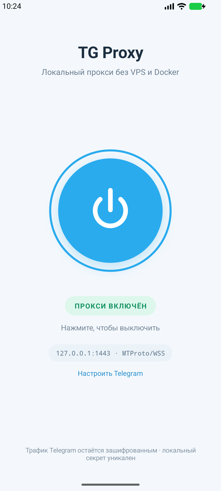

# One-Tap Telegram Proxy

Нативное Android-приложение, которое запускает локальный MTProto-прокси
**прямо на телефоне**. Docker, root и собственный VPS не нужны.



## Как это работает

```text
Telegram
   │  MTProto Proxy + уникальный секрет
   ▼
127.0.0.1:1443
   │
   ├── официальный Telegram WSS (основной)
   ├── WSS через Cloudflare-маршрут (резервный)
   └── прямой Telegram TCP (последний резерв)
```

Приложение держит локальный MTProto→WSS мост в Android Foreground Service.
Порт привязан только к `127.0.0.1` и недоступен из Wi-Fi или мобильной сети.
Для каждой установки генерируется отдельный 16-байтный секрет. MTProto-трафик
перешифровывается между локальной и исходящей транспортными сессиями, но
содержимое сообщений не расшифровывается.

TLS-сертификат и имя каждого WSS-сервера проверяются системным хранилищем
Android. При использовании Cloudflare-маршрута внешний узел видит сетевые метаданные
(например, IP и объём соединения), но полезная нагрузка остаётся защищена
MTProto Telegram.

## Использование

1. Установите свежий APK и нажмите большую кнопку.
2. Разрешите уведомления — постоянное уведомление необходимо foreground-service.
3. Разрешите TG Proxy работать без оптимизации батареи. Это необходимо для
   непрерывной передачи трафика, когда поверх приложения открыт Telegram.
4. Telegram покажет штатное подтверждение MTProto-прокси
   `127.0.0.1:1443`. Нажмите **«Подключить прокси»**.
5. Приложение запомнит настройку только после первого настоящего ответа от
   Telegram через прокси. После обновления до 1.2.0 окно настройки поэтому
   откроется один раз, даже если прокси настраивался в старой сборке.

После успешного обмена данными следующие включения запускают сервер и открывают
сам Telegram без повторного окна настройки. Ссылка **«Настроить Telegram»**
сбрасывает эту отметку и повторно открывает правильную конфигурацию.

### Кнопка в панели быстрых настроек

Нажмите в приложении **«Добавить кнопку в шторку»**. На Android 13+ подтвердите
системный запрос. На Android 8–12 откройте редактирование панели быстрых
настроек, найдите плитку **TG Proxy** и перетащите её в активную область.
Значок щита с молнией включает и выключает foreground-service без открытия
приложения. Перед первым использованием плитки один раз включите прокси из
приложения, выдайте системные разрешения и подтвердите настройку в Telegram.

## Сборка

Требуются JDK 17 и Android SDK 34:

```bash
export JAVA_HOME=$(/usr/libexec/java_home -v 17)
./gradlew :app:testDebugUnitTest :app:assembleDebug :app:lintDebug
```

APK: `app/build/outputs/apk/debug/app-debug.apk`.

```bash
adb install -r app/build/outputs/apk/debug/app-debug.apk
```

### Подписанный APK для распространения

Release-сборка читает ключ из `~/.gradle/tg-proxy-keystore.properties`.
Сам ключ и этот файл с паролем нельзя добавлять в репозиторий или отправлять
вместе с APK. Собрать подписанную версию:

```bash
./gradlew :app:assembleRelease
```

Результат: `app/build/outputs/apk/release/app-release.apk`. Для всех будущих
обновлений необходимо использовать тот же ключ и увеличивать `versionCode`.

Поддерживается Android 8.0+ (`minSdk 26`).

## Ограничения

- С версии 1.9.3 прокси не удерживает CPU от сна: wakelock и разрешение
  `WAKE_LOCK` удалены. Во сне Android может приостановить передачу данных;
  сообщения и звонки через прокси могут задерживаться. Foreground service,
  уведомление и восстановление после пробуждения сохранены. Само приложение
  не будит телефон для проверки экрана; обычный таймер выполняется, когда CPU работает.
- Это прокси только для Telegram, не системный VPN.
- Работоспособность зависит от доступности хотя бы одного WSS/Cloudflare/TCP
  маршрута в конкретной сети.
- Публичный Cloudflare-маршрут — внешняя транспортная инфраструктура, хотя
  содержимое Telegram остаётся зашифрованным.
- Android может остановить сервис после принудительной остановки приложения или
  из-за агрессивного энергосбережения. На Huawei/Honor откройте
  **Настройки → Батарея → Запуск приложений → TG Proxy**, отключите
  автоматическое управление и разрешите автозапуск, косвенный запуск и работу
  в фоновом режиме. При наличии отдельной настройки оптимизации батареи также
  исключите TG Proxy из оптимизации.
- После длительного выключения экрана приложение сначала ждёт стабильную
  подтверждённую Android сеть, затем полностью перезапускает локальный listener
  `127.0.0.1:1443` с короткой паузой между остановкой и запуском. Это
  воспроизводит успешное ручное выключение/включение через плитку и помогает
  Telegram выйти из backoff старого локального соединения. При этом сведения
  о недоступных прямых маршрутах сохраняются, если сеть не изменилась. Состояние экрана
  дополнительно проверяется раз в две секунды, поэтому восстановление работает
  и при пропущенном системном событии `SCREEN_ON`. Смена Wi-Fi/мобильной сети
  также принудительно пересоздаёт активные сессии.
- Как и в WebSocket-мосте Flowseal, рабочая сессия не закрывается по времени
  ожидания ответа на зашифрованные пакеты: прокси не знает, нужен ли на них ответ.
  Сессию завершают EOF, сетевая ошибка, остановка сервиса или восстановление сети.
  При «чёрной дыре» без TCP-ошибки обнаружение зависания остаётся за Telegram/TCP.
- Исходящие WSS-соединения открываются по запросу Telegram. Предварительный пул
  отключён: Android-реализация не отслеживает EOF простаивающих TLS-сокетов.
  Это добавляет время TCP/TLS handshake к новому подключению, но не выдаёт
  Telegram старый сокет из пула.
- При выключении локального сервиса сохранённая настройка Telegram остаётся
  активной. Повторное включение восстанавливает соединение.

## Происхождение runtime

Runtime основан на MIT-лицензированных
[`crim50n/tg-ws-proxy-android`](https://github.com/crim50n/tg-ws-proxy-android),
[`ihtfw/tg-ws-proxy-android`](https://github.com/ihtfw/tg-ws-proxy-android) и
[`Flowseal/tg-ws-proxy`](https://github.com/Flowseal/tg-ws-proxy).
Подробности: [`THIRD_PARTY_NOTICES.md`](THIRD_PARTY_NOTICES.md).

## Версия 1.9.3: разрешён сон CPU

По запросу пользователя удалено постоянное удержание CPU, включая неиспользуемую
настройку `keepCpuAwake` и разрешение `WAKE_LOCK`. Это не режим «только при открытом
Telegram»: сервер остаётся включённым, но больше не мешает Android усыплять CPU.
Порт, секрет, подпись, плитка и логика восстановления после сна не менялись.
Настройки ручного запуска Huawei остаются настройками телефона.

Фактическая экономия батареи и задержки после длительного сна требуют отдельного
замера без USB. Удаление wakelock не гарантирует непрерывную фоновую доставку.

Собран подписанный `TG-Proxy-1.9.3.apk` (versionCode 18): 39 тестов прошли,
lint — 0 ошибок, 8 предупреждений. Проверено отсутствие `WAKE_LOCK` в готовом
APK, сертификат прежний. Проверка этой версии на телефоне пока не выполнена:
установка через ADB завершилась успешно, но длительная проверка работы без USB
после установки не выполнена.

## Версия 1.9.2: повторные сигналы пробуждения

Исправлен ложный перезапуск при дублировании Android `SCREEN_ON` и фоновой
проверки экрана. Короткий сон больше не превращается повторным событием в
«неизвестный», а запланированное восстановление не откладывается этим дублем.
Решение принимается под той же блокировкой, что и чтение длительности сна.

Проверка 1.9.1 по USB не подтвердила стабильность на батарее: пользователь
сообщил о повторных сбоях и долгом подключении после сна. 1.9.2 исправляет
конкретный воспроизведённый дефект, а не объявляет решёнными все эти симптомы.
Локальные отчёты диагностики телефона не включены в репозиторий.

## Версия 1.9.1: быстрее восстанавливаем соединение

- Первая прямая WSS-попытка использует connect timeout 3 секунды вместо 10.
  После таймаута этот IP пропускается в пользу fallback на 5 минут вместо 30 секунд.
  Это таймаут отдельной попытки, не гарантия полного подключения за 3 секунды.
- Перезапуск listener после сна в той же сети сохраняет сведения о недоступных IP.
  Реальная смена сети или новый запуск сервиса разрешают повторные проверки.
- Готовый CF-сокет больше не ждёт завершения соседней попытки подключения:
  домены проверяются последовательно, в порядке предпочтения.
- Добавлены регрессионные проверки задержки CF, сохранения состояния после сна,
  запоздалых ошибок прежней сети и освобождения сокета при отмене.

Краткая проверка через USB не подтверждает стабильность после длительного сна
на батарее.

## Версия 1.9.0: сверка с Flowseal

Основа WebSocket-моста сверена с
[Flowseal/tg-ws-proxy, 307a384](https://github.com/Flowseal/tg-ws-proxy/tree/307a384ab7f522e34bb1a045884d0bd90f40bee5).
Это нативный Kotlin/Java-порт основного сценария, без Python и Docker.

- Убраны эвристические watchdog и блокировка целого маршрута по результатам
  таких watchdog. HTTP-ошибки при подключении по-прежнему дают домену cooldown.
- Исправлены утечка сокета после EOF/Close и ожидание блокировки записи при остановке.
- В журнал `TgProxyRuntime` добавлена причина закрытия каждой сессии.
- Изменение Android VALIDATED на той же сети больше не обрывает соединения.
- Секрет, порт, подпись приложения, плитка и одноразовая настройка Telegram сохранены.

В этом порте не реализованы HTTP/2 media, пользовательские Cloudflare Workers,
входящий Fake TLS/PROXY protocol и desktop UI актуального Flowseal.
Они не нужны для базового локального MTProto→WSS сценария; это не полная копия
всех возможностей desktop-проекта. Подробности и проверки —
[docs/flowseal-port.md](docs/flowseal-port.md).
